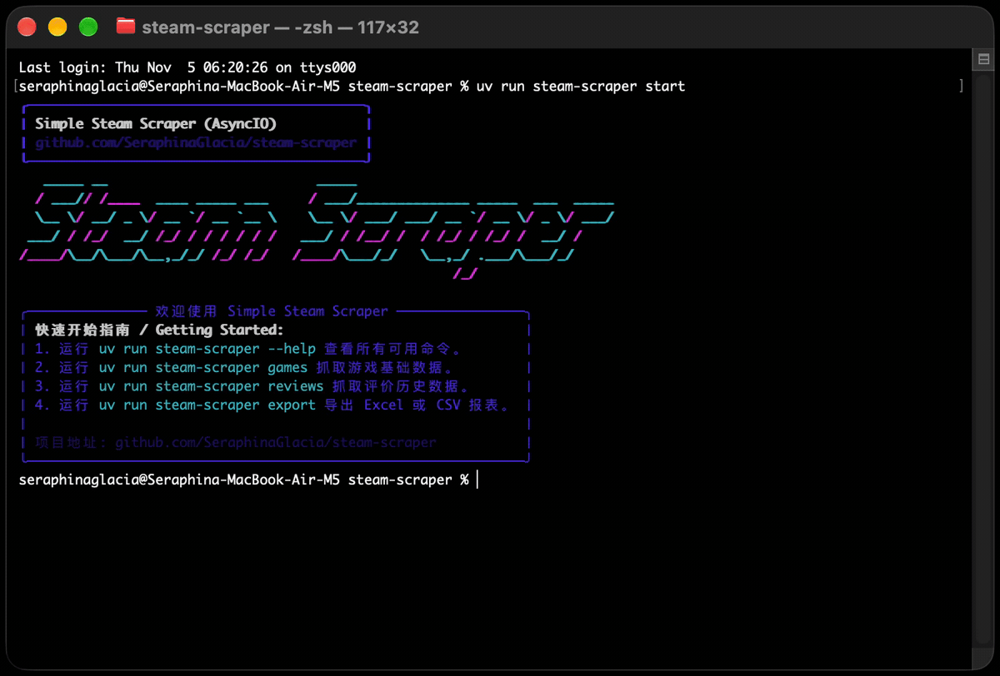

<div align="center">
  <p>
    
  </p>
  <h1>Steam Scraper</h1>
  <p><strong>采集 Steam 游戏信息与评价历史的命令行工具。</strong></p>
  <p>异步采集 · 断点续传 · SQLite 存储 · Excel / CSV 导出</p>

  <p>
    
  </p>

  <p>
    <a href="LICENSE"></a>
    
    
  </p>
  <p><a href="README.md">中文</a> · <a href="README_EN.md">English</a></p>
</div>

从 Steam 商店页面与公开接口获取数据，用于课程作业、数据分析和探索性研究：

- **游戏信息**：AppID、名称、发行日期、价格、开发商、发行商、类型和简介。
- **评价历史**：按日期统计的好评、差评数量，方便与游戏信息关联分析。
- **采集进度**：Rich 终端进度条、失败日志和独立的游戏 / 评价断点。

## 快速开始

先安装 [uv](https://docs.astral.sh/uv/getting-started/installation/)，再克隆项目并同步环境。uv 会按 `.python-version` 自动选择 Python。

```bash
git clone https://github.com/SeraphinaGlacia/steam-scraper.git
cd steam-scraper
uv sync --locked
uv run steam-scraper start
```

先用少量页面检查网络和数据写入，再按需扩大范围：

```bash
uv run steam-scraper games --pages 10
uv run steam-scraper reviews
uv run steam-scraper export
```

全流程命令依次采集游戏、采集评价，并导出 Excel 和 CSV：

```bash
uv run steam-scraper all
```

> [!IMPORTANT]
> 中断后使用 `uv run steam-scraper all --resume` 继续；分步运行时，`games` 和 `reviews` 也支持 `--resume`。不带该参数会清除对应断点，从头处理。失败项目需用 `retry` 补抓。

## 常用命令

所有命令均以 `uv run steam-scraper` 开头；运行 `--help` 或 `<命令> --help` 查看完整参数。

| 命令 | 用途 |
| :--- | :--- |
| `games --pages 10` | 采集前 10 页游戏；省略 `--pages` 则采集全部分页 |
| `reviews` | 采集数据库中已有游戏的评价历史 |
| `reviews --input appids.txt` | 从文本文件读取 AppID，每行一个 |
| `all --resume` | 从断点继续完整流程 |
| `retry` | 重试失败任务；`--type game` / `--type review` 可限定类型 |
| `export` | 导出 Excel；`--output report.xlsx` 可指定文件 |
| `export --format csv` | 导出两份 CSV；`--output exports/` 可指定目录 |
| `clean` | 清理缓存、断点和失败记录，保留数据库与导出文件 |
| `reset` | 删除配置的数据目录中的运行结果 |

> [!TIP]
> 长时间采集后运行 `retry`，并检查剩余失败记录。若游戏信息采集有失败，先用 `retry --type game` 补齐，再采集评价。

> [!CAUTION]
> `clean` 会丢失恢复进度；`reset` 会永久删除数据目录中的文件。任务运行期间不要执行清理或手动删除断点。

## 配置

直接修改根目录的 [config.yaml](config.yaml)，保存后照常运行命令即可。常用设置如下：

| 配置项 | 默认值 | 说明 |
| :--- | :--- | :--- |
| `scraper.language` | `english` | 商店语言，简体中文使用 `schinese` |
| `scraper.currency` | `us` | 商店地区，人民币价格使用 `cn` |
| `scraper.max_workers` | `20` | 并发任务数 |
| `http.timeout` | `30` | 请求超时，单位：秒 |
| `http.max_retries` | `3` | 请求重试设置 |
| `output.data_dir` | `./data` | 数据库、断点、日志及默认导出目录 |

连接池、请求间隔和输出文件名等设置见配置文件。遇到 HTTP 429 或频繁超时，可先将并发数降至 `10`，稍后再运行 `retry`。

> [!NOTE]
> 本项目面向个人学习与数据分析，尚不支持代理池、验证码处理或分布式调度。Steam 页面与接口变化可能影响采集；实际速度取决于网络及访问限制。

## 输出文件

默认保存在 `data/`，可通过 `output.data_dir` 更改：

| 文件 | 内容 |
| :--- | :--- |
| `steam_data.db` | SQLite 数据库，含 `games` 和 `reviews` 两张表 |
| `steam_data.xlsx` | Excel 工作簿，含 `Games` 和 `Reviews` 两个工作表 |
| `steam_games.csv`、`steam_reviews.csv` | UTF-8-SIG 编码的游戏与评价数据 |
| `.checkpoint.json` | 断点进度，供 `--resume` 使用 |
| `failures.json` | 失败任务及原因，供 `retry` 使用 |

## 开发

源码位于 `src/steam_scraper`。依赖与工具配置集中在 `pyproject.toml`，版本由 `uv.lock` 锁定；Ruff、ty 和 pytest 仅属于开发依赖。

```bash
uv lock --check
uv sync --locked --all-groups
uv run ruff format --check .
uv run ruff check .
uv run ty check src
uv run pytest
uv build --no-sources
```

---

<div align="center">
  <p>Made with ❤️ by SeraphinaGlacia / Xinlei Zhou</p>
</div>
