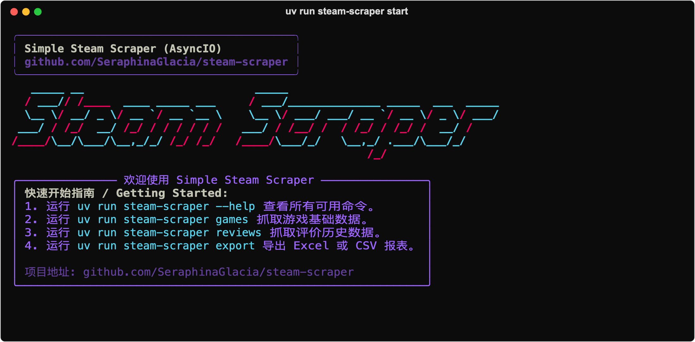

<div align="center">
  <h1>Steam Scraper</h1>
  <p><strong>A command-line tool for Steam game metadata and review history.</strong></p>
  <p>Async collection · Resumable runs · SQLite storage · Excel / CSV export</p>

  <p>
    
  </p>

  <p>
    <a href="LICENSE"></a>
    
    
  </p>
  <p><a href="README.md">中文</a> · <a href="README_EN.md">English</a></p>
</div>

Collect data from Steam store pages and public endpoints for coursework, data analysis, and exploratory research:

- **Game metadata**: AppID, name, release date, price, developers, publishers, genres, and description.
- **Review history**: positive and negative recommendation counts by date, ready to join with game metadata.
- **Progress tracking**: Rich terminal progress bars, failure logs, and separate game / review checkpoints.

## Quick Start

Install [uv](https://docs.astral.sh/uv/getting-started/installation/), then clone the project and sync the environment. uv selects Python using `.python-version`.

```bash
git clone https://github.com/SeraphinaGlacia/steam-scraper.git
cd steam-scraper
uv sync --locked
uv run steam-scraper start
```

Start with a few pages to check connectivity and data storage:

```bash
uv run steam-scraper games --pages 10
uv run steam-scraper reviews
uv run steam-scraper export
```

To collect games, collect reviews, and export both Excel and CSV in one run:

```bash
uv run steam-scraper all
```

> [!IMPORTANT]
> After an interruption, continue with `uv run steam-scraper all --resume`. The individual `games` and `reviews` commands also support `--resume`. Without it, the corresponding checkpoints are cleared and processing starts over. Use `retry` for failed items.

## Commands

Prefix each command with `uv run steam-scraper`. Use `--help` or `<command> --help` for all options.

| Command | Purpose |
| :--- | :--- |
| `games --pages 10` | Collect the first 10 pages; omit `--pages` to collect all pages |
| `reviews` | Collect review history for games in the database |
| `reviews --input appids.txt` | Read AppIDs from a text file, one per line |
| `all --resume` | Resume the full workflow |
| `retry` | Retry failed items; filter with `--type game` / `--type review` |
| `export` | Export Excel; set a file with `--output report.xlsx` |
| `export --format csv` | Export two CSV files; set a directory with `--output exports/` |
| `clean` | Remove caches, checkpoints, and failure logs; keep the database and exports |
| `reset` | Delete generated results in the configured data directory |

> [!TIP]
> After a long run, use `retry` and inspect any remaining failures. If game collection failed, run `retry --type game` before collecting reviews.

> [!CAUTION]
> `clean` discards resume progress; `reset` permanently deletes files in the data directory. Do not run cleanup commands or remove checkpoints while a task is running.

## Configuration

Edit [config.yaml](config.yaml) in the project root, save it, and run the same command. Common settings:

| Setting | Default | Purpose |
| :--- | :--- | :--- |
| `scraper.language` | `english` | Store language; use `schinese` for Simplified Chinese |
| `scraper.currency` | `us` | Store region; use `cn` for prices in RMB |
| `scraper.max_workers` | `20` | Concurrent tasks |
| `http.timeout` | `30` | Request timeout in seconds |
| `http.max_retries` | `3` | Request retry setting |
| `output.data_dir` | `./data` | Database, checkpoints, logs, and default export directory |

See the configuration file for connection pools, request delays, and output filenames. For HTTP 429 responses or frequent timeouts, try lowering concurrency to `10` and running `retry` later.

> [!NOTE]
> This project is intended for personal learning and data analysis. Proxy pools, CAPTCHA handling, and distributed scheduling are not supported. Steam page or endpoint changes may affect collection; throughput depends on your network and access limits.

## Output Files

Files are saved to `data/` by default. Change `output.data_dir` to use another location.

| File | Contents |
| :--- | :--- |
| `steam_data.db` | SQLite database with `games` and `reviews` tables |
| `steam_data.xlsx` | Excel workbook with `Games` and `Reviews` worksheets |
| `steam_games.csv`, `steam_reviews.csv` | Game and review data encoded as UTF-8-SIG |
| `.checkpoint.json` | Progress used by `--resume` |
| `failures.json` | Failed tasks and reasons used by `retry` |

## Development

Source code lives in `src/steam_scraper`. Dependencies and tools are configured in `pyproject.toml`, with versions locked in `uv.lock`. Ruff, ty, and pytest are development dependencies only.

```bash
uv lock --check
uv sync --locked --all-groups
uv run ruff format --check .
uv run ruff check .
uv run ty check src
uv run pytest
uv build --no-sources
```

<div align="center">
  <p>Made with ❤️ by SeraphinaGlacia / Xinlei Zhou</p>
</div>
